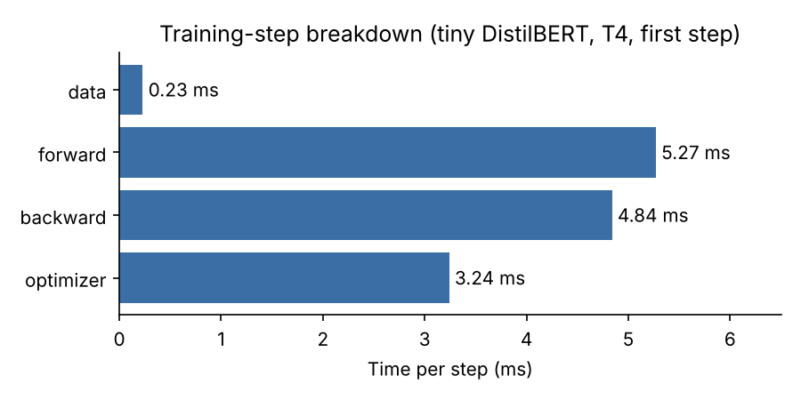
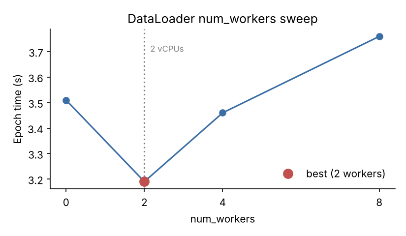
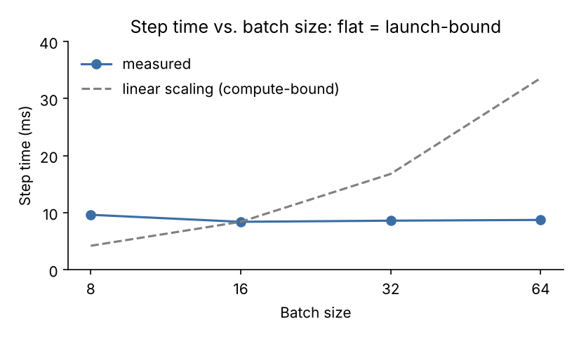

# Profiling and Accelerating DistilBERT Fine-Tuning in PyTorch

## Abstract

This project fine-tunes DistilBERT on IMDB sentiment classification with a hand-written PyTorch training loop, then profiles the training step and tries the standard levers for speeding it up. It covers:

- **A custom training loop:** truncating tokenization, a dynamic-padding `collate_fn`, and a minimal forward/backward/step loop
- **Phase-level timing:** data, forward, backward, and optimizer time per step, with `torch.cuda.synchronize()` so asynchronous GPU work is attributed to the right phase
- **Input pipeline tuning:** a `num_workers` sweep, and pinned memory with `non_blocking` host-to-device copies
- **Bottleneck diagnosis:** a PyTorch Profiler trace plus a batch-size scaling test to classify the step as launch-bound, compute-bound, or input-bound
- **Compilation:** graph-break detection and removal, and the `torch.compile` speedup and break-even step count
- **Mixed precision and optimizers:** fp16 autocast with `GradScaler`, and SGD vs. Adam vs. AdamW on time, convergence, and memory

All code, outputs, and the full analysis are in the [notebook](distilbert_profiling.ipynb).

## Experimental setup

| Item | Value |
|---|---|
| Platform | Google Colab |
| GPU | NVIDIA Tesla T4 (Turing, compute capability 7.5, 40 SMs, 15.6 GB) |
| CPU | 2 vCPUs |

### Software stack

| Component | Version / details |
|---|---|
| CUDA runtime / driver API | 13.0 / 13.0 (CUPTI 13.0.1) |
| Python | 3.13 |
| PyTorch | 2.11.0+cu130 |
| transformers | 4.46.3 |
| datasets | 3.1.0 |
| accelerate | 1.1.1 |

### Environment setup

1. Open the notebook in Google Colab and select a T4 GPU runtime (Runtime → Change runtime type). It also runs on any CUDA machine, or on CPU with the GPU experiments skipped.
2. Install the pinned Hugging Face libraries (PyTorch comes preinstalled on Colab):
   ```bash
   pip install transformers==4.46.3 datasets==3.1.0 accelerate==1.1.1 matplotlib
   ```
3. Run all cells. The tokenizer and the 300-row IMDB sample (`data/tiny_imdb.jsonl`) are downloaded on first run if they are not present locally.
4. The profiler trace is written to `traces/hw2_c4_trace.json`. Open it in [Perfetto](https://ui.perfetto.dev) or `chrome://tracing`.

### Models and data

- **Tiny model:** a randomly initialized DistilBERT with 2 layers, hidden size 32, 4 heads, and 999,074 parameters. It shares the `distilbert-base-uncased` vocabulary (30,522 tokens) and is used for the timing, profiling, and compile experiments.
- **Full model:** pretrained `distilbert-base-uncased` (66,955,010 parameters), used for fine-tuning, mixed precision, and the optimizer comparison.
- **Data:** the first 2,000 reviews of the IMDB training split for the GPU experiments, plus a balanced 300-row sample for quick checks.

### Methodology

- **Timing:** `time.perf_counter()` with `torch.cuda.synchronize()` before every timestamp. Averages are taken after 2–3 warm-up steps.
- **Profiling:** `torch.profiler` with CPU and CUDA activities over 3 training steps, with `forward`, `backward`, and `optimizer` regions labeled via `record_function`.
- **Graph breaks:** counted with `torch._dynamo.explain`.
- **Memory:** `torch.cuda.max_memory_allocated()` after `reset_peak_memory_stats()`, over 5 steps per configuration.

## Results

### 1. Fine-tuning (pretrained DistilBERT, AdamW lr = 5e-5, batch 32, max_len 256)

| Metric | Value |
|---|---|
| Steps run | 50 (≈0.8 epoch over 2,000 reviews) |
| Final step training loss | 0.0013 |
| Training accuracy (full pass over the 2,000 rows, eval mode) | 1.0000 |

### 2. Per-step timing breakdown (tiny model, batch 8 × 64)

| Phase | Time (ms) | Share of total |
|---|---|---|
| data (H2D copy) | 0.23 | 2% |
| forward (+ loss) | 5.27 | 38% |
| backward | 4.84 | 35% |
| optimizer (zero_grad + step) | 3.24 | 24% |
| **total** | **13.70** | 100% |

This was the model's first step, so the optimizer time includes AdamW lazily allocating its state. The trace shows 88 kernels for that first `AdamW.step` versus 8 in later steps. Without a sync before each timestamp, each phase would be charged only for queuing its kernels, and the real GPU time would be billed to the next blocking call (`loss.item()`).



### 3. Input pipeline (2,000 rows, batch 16, 125 steps per epoch)

| num_workers | Epoch time (s) |
|---|---|
| 0 | 3.51 |
| **2** | **3.19** (best, −9%) |
| 4 | 3.46 |
| 8 | 3.76 |

The curve is U-shaped. Two workers move tokenization off the main process. Four or more workers oversubscribe the 2 vCPUs and compete with the main process, which is itself busy launching kernels. Pinned memory with `non_blocking=True` copies made no measurable difference (3.46 s → 3.50 s at 4 workers): the trace shows all H2D copies over 3 steps totaling 0.029 ms of GPU time, so there is nothing to overlap.



### 4. Bottleneck diagnosis: launch-bound

| Batch size | Step time (ms) |
|---|---|
| 8 | 9.63 |
| 16 | 8.40 |
| 32 | 8.60 |
| 64 | 8.73 |



Steady-state step from the profiler trace:

| Region | CPU time | Kernels | GPU kernel time |
|---|---|---|---|
| forward | 6.59 ms | 43 | 0.43 ms |
| backward | 9.50 ms | 98 | 1.08 ms |
| optimizer (AdamW.step) | 1.82 ms | 8 | 0.49 ms |

- **Flat batch scaling:** step time doesn't grow with batch size, so the cost is fixed per-step overhead (Python dispatch and kernel launches), not compute.
- **Idle GPU:** 527 kernels run for 6.2 ms inside a 69 ms window, about 9% GPU occupancy.
- **Launch cost exceeds kernel time:** the median kernel lasts 7.6 µs, and the `cudaLaunchKernel` calls take 7.5 ms of CPU time, more than the GPU work they launch.

The first fix to try is cutting kernel launches with `torch.compile(mode="reduce-overhead")`, which fuses small kernels and replays the step as a CUDA graph.

### 5. Graph breaks

| Function | Graph breaks |
|---|---|
| `if x.sum() > 0: return x.sin()` else `x.cos()` | 1 |
| `torch.where(x.sum() > 0, x.sin(), x.cos())` | **0** |

The Python `if` on a tensor value forces Dynamo to stop tracing, evaluate the condition eagerly (a device-to-host read on GPU), and start a new graph. The branchless rewrite keeps the condition as a tensor, so the whole function compiles to one graph at the cost of always computing both branches.

### 6. `torch.compile` (tiny model, batch 8 × 64, default mode)

| | Value |
|---|---|
| Eager step | 8.77 ms |
| Compiled step | 6.78 ms (1.29× faster) |
| Per-step saving | 1.99 ms |
| One-time compile cost | 0.66 s |
| **Break-even** | 0.66 s / 1.99 ms ≈ **330 steps** |

The gain is modest because the step is launch-bound: default-mode Inductor fuses elementwise ops into fewer kernels, but each remaining kernel is still launched from the CPU, and the optimizer step stays eager.

### 7. Mixed precision (pretrained DistilBERT, batch 32 × up to 256 tokens)

| | Peak allocated |
|---|---|
| fp32 | 5,604 MB |
| AMP (fp16 autocast + GradScaler) | 5,119 MB |
| **Change** | **−485 MB (−8.7%)** |

Only the activations saved for backward shrink. The fp32 master weights (~268 MB), gradients (~268 MB), and AdamW state (~536 MB) are unchanged. Autocast runs the matmul-heavy ops (Q/K/V and output projections, FFN linears, attention batched matmuls) in fp16 on the T4's Tensor Cores and keeps softmax, LayerNorm, and the loss in fp32.

### 8. Optimizers (pretrained DistilBERT, lr = 5e-5, batch 32, 20 steps)

| Optimizer | 20-step time | Final loss | State (bytes/param) | State for DistilBERT |
|---|---|---|---|---|
| SGD (no momentum) | 16.59 s | 0.7050 | 0 | 0 MB |
| Adam | 18.15 s | 0.0056 | 8 | ≈536 MB |
| AdamW | 16.75 s | 0.0049 | 8 | ≈536 MB |

Step times are within noise of each other, since the update is small next to the forward and backward passes. Convergence is what separates them: SGD's loss stays at ≈ ln 2 (chance) because 5e-5 is far too small a step without adaptive per-parameter scaling. AdamW reaches the 0.1 target loss fastest at the same memory cost as Adam.

## Attribution

This work was completed as a homework assignment for COMS 6998: High Performance Machine Learning at Columbia University, taught by Dr. Kaoutar El Maghraoui. The notebook template, tiny model configuration, dataset wrapper, and parts of the benchmark harness were provided by the course. The tokenization and collate functions, training step, timing, profiling, mixed-precision, and optimizer functions, the graph-break fix, and all experiments were developed and run by the author. AI assistants (Claude) were used to help debug code, explain concepts, and draft and edit the written analysis; all results are from the author's own measurements.

---

*Nrushad Joshi, Columbia University*
