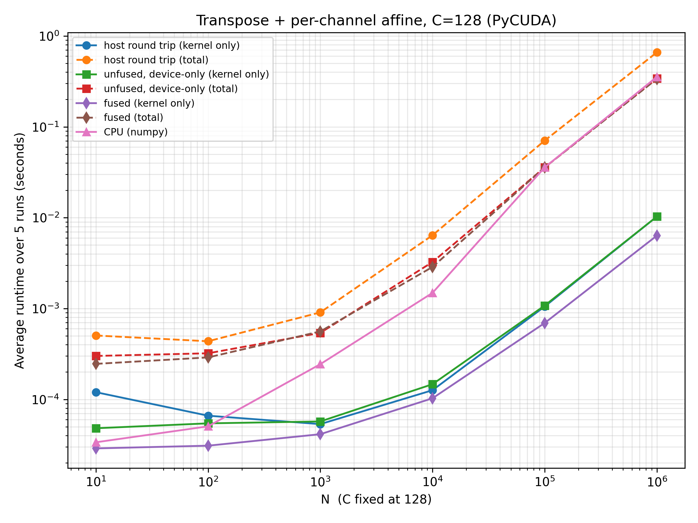
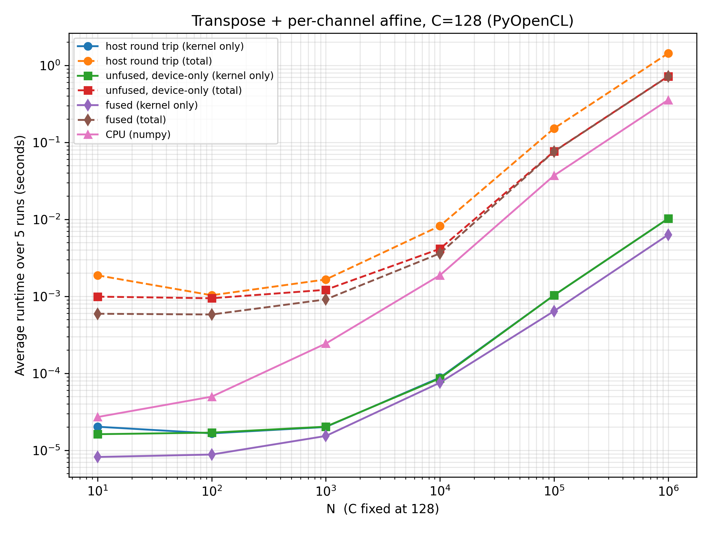
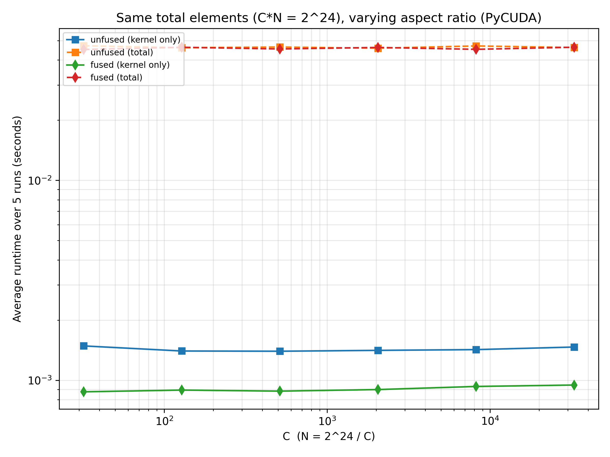
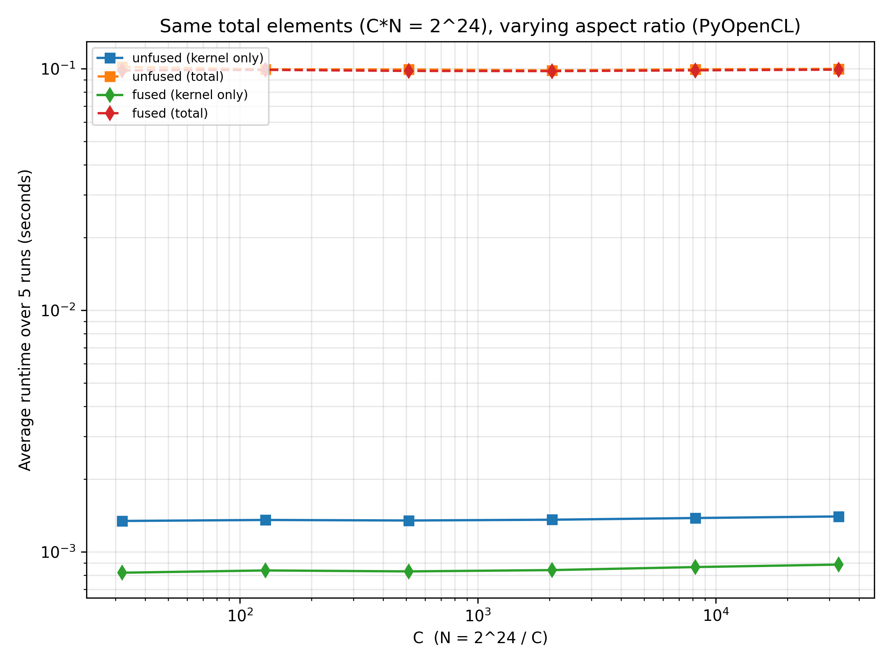

# Kernel Fusion on the GPU: Layout Conversion + Per-Channel Affine

CUDA and OpenCL kernels (driven from PyCUDA and PyOpenCL) that fuse a
channel-major → batch-major layout conversion with a per-channel affine
transform. The project compares three implementations and profiles them with
NVIDIA Nsight Systems and Nsight Compute.

## Problem

Inference pipelines convert tensors between layouts between stages, and at
inference time BatchNorm folds into a per-channel scale and shift:

```
X     : (C, N) float32, channel-major
gamma : (C,)   float32
beta  : (C,)   float32
Y     : (N, C) float32, batch-major

Y[n, c] = gamma[c] * X[c, n] + beta[c]
```

| Version | Kernels | Intermediate `Xt` |
|---|---|---|
| `unfused_hostroundtrip()` | transpose → affine | copied device → host → device |
| `unfused()` | transpose → affine | stays in device global memory |
| `fused()` | one fused kernel | never materialized |

Comparing the first two isolates the cost of a host round trip. Comparing the
last two isolates the cost of materializing the intermediate in device global
memory and launching one extra kernel.

## Results (NVIDIA L4, CUDA 12.6)

**Fusion cuts kernel time by 1.62×** at C=128, N=10⁶: 6.35 ms vs. 10.29 ms
(PyCUDA) and 6.30 ms vs. 10.23 ms (PyOpenCL).

**It halves DRAM traffic**, as the byte model predicts (C=256, N=65536):

| | Predicted | Measured (Nsight Compute) | Ratio |
|---|---|---|---|
| Unfused (transpose + affine) | 16CN = 268.4 MB | 264.3 MB | 0.985 |
| Fused | 8CN = 134.2 MB | 138.1 MB | 1.029 |

**End-to-end time is PCIe-bound.** Host transfers make up over 95% of total
time at large N, so `unfused()` and `fused()` totals differ by only about 1%.
The host round trip roughly doubles total time (661 ms vs. 341 ms at N=10⁶).

**Launch overhead only matters at small N.** At N=4096 the `cuLaunchKernel`
call costs 28–220% of the kernel's duration; at N=65536 it is 3–9%. The gap
between the two unfused kernels drops from 138 µs at N=4096 to a constant
5.7 µs once the first kernel outlasts the host-side launch path.

**Store coalescing is the remaining bottleneck.** With `n` mapped to
`threadIdx.x`, the read from `X` is contiguous, but the write to `Y` has a
stride of 4C bytes:

| Kernel | Global store efficiency | Global load efficiency |
|---|---|---|
| transpose | 12.5% (4 of 32 bytes per sector) | 100% |
| affine | 100% | 100% |
| fused | 12.5% | 70.8%* |

\*The `X` read is fully coalesced. The average is pulled down by the
warp-uniform `gamma[c]`/`beta[c]` loads, each of which fetches a full sector
for 4 useful bytes.

Fusion removes the intermediate array but not the transpose's strided store.
The natural next step is a shared-memory tiled transpose (32×33 tile to avoid
bank conflicts), which would make both the global loads and the global stores
coalesced.

### Benchmark sweep (C = 128)

| PyCUDA | PyOpenCL |
|---|---|
|  |  |

### Aspect-ratio sweep (C·N = 2²⁴)

Runtime is nearly flat (fused kernel: 0.876 → 0.947 ms from C=32 to
C=32768). The store stride is ≥128 bytes at every point in the sweep, so
coalescing behaviour doesn't change with aspect ratio.

| PyCUDA | PyOpenCL |
|---|---|
|  |  |

### Nsight Systems timelines (C=256, N=65536)

`unfused()`: two kernels back to back, no memcpy in between


`fused()`: HtoD → one kernel → DtoH


### Nsight Compute

DRAM bytes read/written (ID 0 = transpose, 1 = affine, 2 = fused)


Global load/store bytes per sector


## Running

Requires an NVIDIA GPU with CUDA and an OpenCL runtime.

```bash
pip install -r requirements.txt

# correctness (edge cases: C or N = 1, non-multiples of 32, extreme aspect ratios)
python3 fused_transpose_affine_pycuda.py -m test
python3 fused_transpose_affine_pyopencl.py -m test

# benchmarks (write plots to the current directory)
python3 fused_transpose_affine_pycuda.py -m bench
python3 fused_transpose_affine_pycuda.py -m ratio
python3 fused_transpose_affine_pyopencl.py -m bench
python3 fused_transpose_affine_pyopencl.py -m ratio

# profiling (PyCUDA)
nsys profile --trace=cuda --stats=true -o nsys_report \
    python3 fused_transpose_affine_pycuda.py -m profile-nsys
ncu --set full -o ncu_report \
    python3 fused_transpose_affine_pycuda.py -m profile-ncu
```

If `ncu` reports `ERR_NVGPUCTRPERM`, run it with
`sudo env "PATH=$PATH" "LD_LIBRARY_PATH=$LD_LIBRARY_PATH" ncu ...`, or set
`NVreg_RestrictProfilingToAdminUsers=0` in the NVIDIA driver options.

## Tools

PyCUDA · PyOpenCL · CUDA C · OpenCL C · Nsight Systems 2024.4 · Nsight Compute 2024.3 · NumPy · Matplotlib
